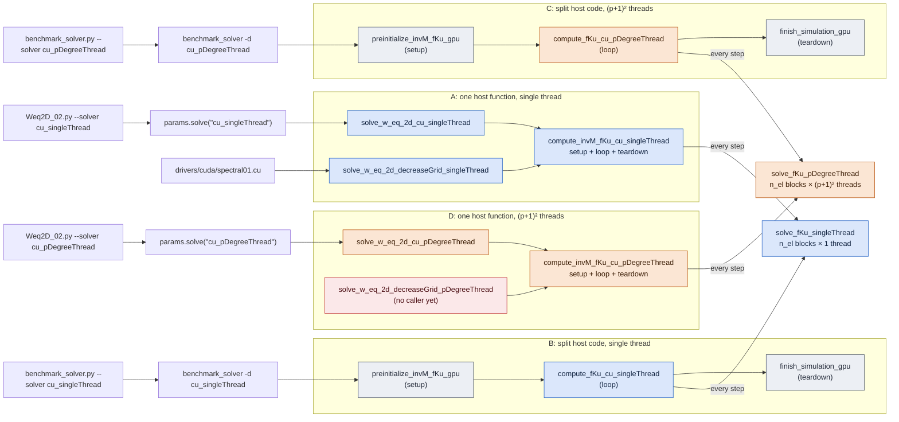
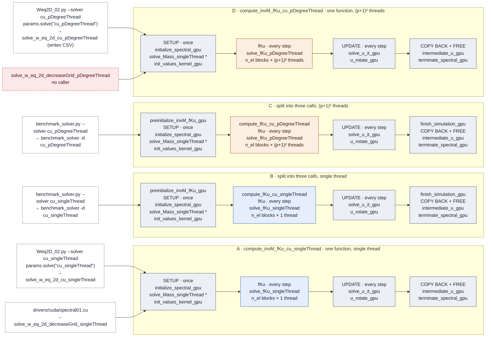

# GPU solver: paths and names

This file is intended to server as a visual help on the different versions that are available when using GPU. How the GPU solver of this repo is reached, what each path runs, and which code belongs to which GPU version. `.cu` means [src/cuontheFly.cu](src/cuontheFly.cu) and `.cuh` means [inc/cuontheFly.cuh](inc/cuontheFly.cuh).

## Naming rule

| Name part | Meaning |
|---|---|
| `singleThread` | GPU code used only by the version with one thread per element |
| `pDegreeThread` | GPU code used only by the version with $(p+1)^2$ threads per element|
| `*_gpu` | GPU code used by every path |
| `cu_*` in a host function | host code of the CUDA library: `solve_w_eq_2d_cu_*`, `compute_invM_fKu_cu_*`, `compute_fKu_cu_*` |
| `_flat`, `_matrices` (only in `cubase`) | raw array in the GPU memory layout, or `std::vector<Matrixt>`; unrelated to the two GPU versions |
| `reference::` (only in `cubase`) | CPU versions of the algorithms, used only to check GPU results |

One exception: the mass kernel `solve_Mass_singleThread` runs in every path, but keeps `singleThread` because the kernel itself uses one thread per element.

## Entry points at a glance

<!-- THIS IS GOLD. NEVER ERASE, JUST UPDATE -->
Which command reaches which host function, and which fKu kernel each path launches every step. The next section shows the same four paths stage by stage.

Blue: used only by the single-thread version. Orange: used only by the $(p+1)^2$-thread version. Grey: used by every path. Red: no caller.

## The four GPU paths

Each row is one path: what you run on the left, then the four stages it goes through on the GPU. Blue: only the single-thread version. Orange: only the $(p+1)^2$-thread version. Grey: every path. Red: no caller. The host function that runs the stages is named in the row title (A, D) or at the top of each stage (B, C).

\* `solve_Mass_singleThread` runs in every path; it keeps its name because the kernel itself uses one thread per element. fKu and UPDATE repeat `nsteps` times.

The two GPU versions differ in one kernel only: `solve_fKu_*`, the element operator that runs every time step. Setup, the update kernels and teardown are the same code in every path.

- **A and D** are one host function each, which does setup, the time loop and teardown: `compute_invM_fKu_cu_singleThread` and `compute_invM_fKu_cu_pDegreeThread`. They copy `u` back every 50 steps and write it to the CSV.
- **B and C** split the same work into three calls: `preinitialize_invM_fKu_gpu` (setup), `compute_fKu_cu_*` (time loop) and `finish_simulation_gpu` (teardown). `benchmark_solver` calls them one after the other.
- **A and B** launch `solve_fKu_singleThread` with one thread per element. **C and D** launch `solve_fKu_pDegreeThread` with $(p+1)^2$ threads per element.

## Entry points

| What you run | Path | First GPU-library call |
|---|---|---|
| `Weq2D_02.py --solver cu_singleThread`, or `params.solve("cu_singleThread", file)` from Python ([params.cpp:115](../spectralcm/src/params.cpp#L115-L124)) | A | `solve_w_eq_2d_cu_singleThread(params, w, name)`, writes the CSV |
| `Weq2D_02.py --solver cu_pDegreeThread`, or `params.solve("cu_pDegreeThread", file)` ([params.cpp:126](../spectralcm/src/params.cpp#L126-L135)) | D | `solve_w_eq_2d_cu_pDegreeThread(params, w, name)`, writes the CSV |
| [drivers/cuda/spectral01.cu:63](../drivers/cuda/spectral01.cu#L63) | A | `solve_w_eq_2d_decreaseGrid_singleThread` |
| `benchmark_solver.py --solver cu_singleThread`, which runs `benchmark_solver -d cu_singleThread` ([benchmark_solver.cu:123](../roofline/solver/benchmark_solver.cu#L123)) | B | `preinitialize_invM_fKu_gpu`, `compute_fKu_cu_singleThread`, `finish_simulation_gpu` |
| `benchmark_solver.py --solver cu_pDegreeThread`, which runs `benchmark_solver -d cu_pDegreeThread` ([:132](../roofline/solver/benchmark_solver.cu#L132)) | C | `preinitialize_invM_fKu_gpu`, `compute_fKu_cu_pDegreeThread`, `finish_simulation_gpu` |
| `roofline_cuda -o 57\|82\|84 -v 1\|2` ([roofline.cu](../roofline/cuda/roofline.cu)) | none | one device helper at a time through a test wrapper: `-v 1` the `singleThread` one, `-v 2` the `pDegreeThread` one |

## Inside the fKu kernel: two families of helpers

Each fKu kernel calls its own copy of the sum-factorization helpers. Indented rows are called by the row above them.

| Step | `solve_fKu_singleThread` (.cu:[1040](src/cuontheFly.cu#L1040)) | `solve_fKu_pDegreeThread` (.cu:[1093](src/cuontheFly.cu#L1093)) |
|---|---|---|
| element load vector | `get_Force_xy_singleThread` [:1152](src/cuontheFly.cu#L1152) | `get_Force_xy_pDegreeThread` [:1169](src/cuontheFly.cu#L1169) |
| stiffness product (Alg. 8.4) | `alg_84_kernel_singleThread` [:1336](src/cuontheFly.cu#L1336) | `alg_84_kernel_pDegreeThread` [:1383](src/cuontheFly.cu#L1383) |
| ↳ merge B and Bdiff | `alg_84_mergeBd_kernel_singleThread` [:1439](src/cuontheFly.cu#L1439) | `alg_84_mergeBd_kernel_pDegreeThread` [:1451](src/cuontheFly.cu#L1451) |
| ↳ swap axes in place | `swapaxes_inplace_kernel_singleThread(B)` [:1704](src/cuontheFly.cu#L1704) | `swapaxes_inplace_kernel_pDegreeThread(A, B)` [:1724](src/cuontheFly.cu#L1724), `A` is scratch |
| ↳ element-wise × and + | `vectorwise_mul` [:1640](src/cuontheFly.cu#L1640), `vectorwise_sum` [:1647](src/cuontheFly.cu#L1647) | written inline |
| ↳ sum factorization | `alg_57_kernel_singleThread` (below) | `alg_57_kernel_pDegreeThread` (below) |
| mass-type product (Alg. 8.2) | `alg_82_kernel_singleThread` [:1483](src/cuontheFly.cu#L1483) | `alg_82_kernel_pDegreeThread` [:1499](src/cuontheFly.cu#L1499) |
| ↳ swap axes into a copy | `swapaxes_copy_kernel_singleThread(B)` [:1654](src/cuontheFly.cu#L1654), returns a new array | `swapaxes_copy_kernel_pDegreeThread(A, const B)` [:1677](src/cuontheFly.cu#L1677), writes into `A` |
| ↳ element-wise × | `vectorwise_mul` | written inline |
| sum factorization (Alg. 5.7) | `alg_57_kernel_singleThread` [:1547](src/cuontheFly.cu#L1547) | `alg_57_kernel_pDegreeThread` [:1585](src/cuontheFly.cu#L1585) |
| ↳ slice of R | `getRfraction_kernel_singleThread` [.cuh:410](inc/cuontheFly.cuh#L410) | `getRfraction_kernel_pDegreeThread` [:1794](src/cuontheFly.cu#L1794) |
| ↳ slice of P | `getPfraction_kernel` [.cuh:440](inc/cuontheFly.cuh#L440) | written inline |
| ↳ matrix × vector | `matvec_kernel` [:1623](src/cuontheFly.cu#L1623) | written inline |
| ↳ swap P and T | `swappy_singleThread` [.cuh:465](inc/cuontheFly.cuh#L465) | `swappy_pDegreeThread` [:1807](src/cuontheFly.cu#L1807) |
| copy of R (inside the swaps) | `getRcopy_kernel` [.cuh:424](inc/cuontheFly.cuh#L424) | written inline |
| shared by both | `createLocationMapcuda` [:1764](src/cuontheFly.cu#L1764) (uses `arangecu` [:1787](src/cuontheFly.cu#L1787)), `slice_kernel` [:1821](src/cuontheFly.cu#L1821) | same |

`alg_82_kernel_singleThread` also runs in every path: the mass kernel `solve_Mass_singleThread` calls it once at setup.

**Scratch memory.** The two families get their working arrays differently. `solve_fKu_singleThread` keeps the element data in fixed-size per-thread arrays (`MAX_PSIZE`), but three of its helpers allocate scratch arrays with device-side `new` and free them again on every call: `alg_57_kernel_singleThread` (four arrays), `swapaxes_copy_kernel_singleThread` and `swapaxes_inplace_kernel_singleThread`. The `pDegreeThread` family uses only fixed-size `__shared__` arrays sized by `MAX_pD`, one set per block, and never allocates on the device heap. Allocating inside the time loop costs time in `cu_singleThread` (not measured separately), and it is why `compute-sanitizer --tool memcheck` with device-heap tracking exceeds the laptop's kernel time limit for `cu_singleThread`.

## All names by version

### `singleThread`: only the version with one thread per element

| Name | Kind | Defined | Called from |
|---|---|---|---|
| `solve_fKu_singleThread` | kernel `<<<n_el, 1>>>` | .cu:[1040](src/cuontheFly.cu#L1040) | `compute_invM_fKu_cu_singleThread` (A), `compute_fKu_cu_singleThread` (B), `test_fku_solverVersion` (version 1) |
| `compute_invM_fKu_cu_singleThread` | host: setup + loop + teardown (A) | .cu:[123](src/cuontheFly.cu#L123) | the two entry functions below |
| `compute_fKu_cu_singleThread` | host: loop only (B) | .cu:[447](src/cuontheFly.cu#L447) | [benchmark_solver.cu:123](../roofline/solver/benchmark_solver.cu#L123) |
| `solve_w_eq_2d_cu_singleThread` | host entry, writes the CSV | .cu:[35](src/cuontheFly.cu#L35) | [params.cpp:120](../spectralcm/src/params.cpp#L120) |
| `solve_w_eq_2d_decreaseGrid_singleThread` | host entry | .cu:[81](src/cuontheFly.cu#L81) | [spectral01.cu:63](../drivers/cuda/spectral01.cu#L63) |
| device helpers | | | left column of the fKu table above |

### `pDegreeThread`: only the version with $(p+1)^2$ threads per element

| Name | Kind | Defined | Called from |
|---|---|---|---|
| `solve_fKu_pDegreeThread` | kernel `<<<n_el, (p+1)²>>>` | .cu:[1093](src/cuontheFly.cu#L1093) | `compute_invM_fKu_cu_pDegreeThread` (D), `compute_fKu_cu_pDegreeThread` (C), `test_fku_solverVersion` (version 2) |
| `compute_invM_fKu_cu_pDegreeThread` | host: setup + loop + teardown (D) | .cu:[249](src/cuontheFly.cu#L249) | the two entry functions below |
| `compute_fKu_cu_pDegreeThread` | host: loop only (C) | .cu:[536](src/cuontheFly.cu#L536) | [benchmark_solver.cu:132](../roofline/solver/benchmark_solver.cu#L132) |
| `solve_w_eq_2d_cu_pDegreeThread` | host entry, writes the CSV | .cu:[58](src/cuontheFly.cu#L58) | [params.cpp:131](../spectralcm/src/params.cpp#L131) |
| `solve_w_eq_2d_decreaseGrid_pDegreeThread` | host entry | .cu:[103](src/cuontheFly.cu#L103) | nobody |
| device helpers | | | right column of the fKu table above |

### `gpu`: every path

| Name | Kind | Defined | Called from |
|---|---|---|---|
| `check_polynomialDegree_gpu` | host: throws `std::invalid_argument` unless 1 ≤ p ≤ `MAX_pD` (5); `MAX_pD` and the check live in `.cuh` | .cuh | `initialize_spectral_gpu`, `test_fku_solverVersion`, `test_mass_singleThread`, `Params::solve` (both `cu_` strings), `benchmark_solver` (every `-d` except `omp`) |
| `initialize_spectral_gpu` | host: allocate, build B, Bdiff, G, W, copy to the GPU | .cu:[671](src/cuontheFly.cu#L671) | A and D loops, `preinitialize_invM_fKu_gpu`, [roofline.cu:86](../roofline/cuda/roofline.cu#L86) |
| `preinitialize_invM_fKu_gpu` | host: setup of B and C | .cu:[378](src/cuontheFly.cu#L378) | [benchmark_solver.cu:118](../roofline/solver/benchmark_solver.cu#L118) |
| `finish_simulation_gpu` | host: copy back + free, for B and C | .cu:[622](src/cuontheFly.cu#L622) | [benchmark_solver.cu:143](../roofline/solver/benchmark_solver.cu#L143) |
| `intermediate_u_gpu` | host: copy `u` to the host | .cu:[821](src/cuontheFly.cu#L821) | A and D loops (every 50 steps), `finish_simulation_gpu` |
| `terminate_spectral_gpu` | host: free device memory | .cu:[804](src/cuontheFly.cu#L804) | A and D loops, `finish_simulation_gpu`, `roofline.cu` |
| `solve_Mass_singleThread` | kernel `<<<n_el, 1>>>`, lumped mass, once | .cu:[1283](src/cuontheFly.cu#L1283) | every path at setup, `test_mass_singleThread` |
| `init_values_kernel_gpu` | kernel, once | .cu:[790](src/cuontheFly.cu#L790) | every path at setup |
| `solve_u_it_gpu` | kernel, every step: $u_{new} = 2u_1 - u_2 + f/m$ | .cu:[659](src/cuontheFly.cu#L659) | every loop |
| `u_rotate_gpu` | kernel, every step: shift the time levels, reset `fku` | .cu:[644](src/cuontheFly.cu#L644) | every loop |
| `createLocationMapcuda`, `arangecu`, `slice_kernel` | device helpers | .cu:[1764](src/cuontheFly.cu#L1764), [1787](src/cuontheFly.cu#L1787), [1821](src/cuontheFly.cu#L1821) | both fKu kernels, the mass kernel |
| `writeU_inter` | host: append one row to the CSV | .cu:[1848](src/cuontheFly.cu#L1848), [1869](src/cuontheFly.cu#L1869) | A and D loops, `benchmark_solver.cu` |

### Test wrappers

| Name | Defined | Runs | Called from |
|---|---|---|---|
| `test_fku_solverVersion(…, version)` | .cu:[842](src/cuontheFly.cu#L842) | one fKu step; `version` 1 = `singleThread`, 2 = `pDegreeThread` | [cutest_onthefly.cu:654](test/cutest_onthefly.cu#L654) (version 2); the version 1 call at :572 is commented out |
| `test_mass_singleThread` | .cu:[1188](src/cuontheFly.cu#L1188) | `solve_Mass_singleThread` | [cutest_onthefly.cu:281](test/cutest_onthefly.cu#L281) |
| `test_alg_84`, `test_alg_84_mergeBd`, `test_alg_82`, `testalg_57` | .cu:[1316](src/cuontheFly.cu#L1316), [1425](src/cuontheFly.cu#L1425), [1466](src/cuontheFly.cu#L1466), [1526](src/cuontheFly.cu#L1526) | one helper; `version` 1 or 2 picks the column of the fKu table | `cutest_onthefly.cu`, `roofline_cuda -v 1\|2` |
| `testlocationMap` | .cu:[1756](src/cuontheFly.cu#L1756) | `createLocationMapcuda` | tests |
| `HelloKernel` | .cu:[1832](src/cuontheFly.cu#L1832) | prints a message | nobody |

## CPU helpers in `cubase`

[inc/cubase.hpp](inc/cubase.hpp) runs on the CPU and has two parts.

| Namespace | What | Main names | Used by |
|---|---|---|---|
| `cie::otFlyGPU` | builds B, Bdiff, G and W before they go to the GPU | `get_ShapesDiffcu`, `ShapeFunctionFactor`, `kron_flat`, `concatenate_flat`; also `kroncu`, `concatenate_matrices`, `arangecu`, `slicecu` and smaller helpers | `initialize_spectral_gpu`, test wrappers |
| `cie::otFlyGPU::reference` | CPU versions of the algorithms on the GPU memory layout, to check GPU results | `compute_fku_ref`, `compute_Mass_ref`, `alg_57_flat`, `alg_57_matrices`, `alg_82_flat`, `alg_82_matrices`, `alg_84_flat`, `alg_84_mergeBd_flat` | unit tests, `roofline_cuda --verify` |

The GPU solver never calls anything in `reference`. Each algorithm therefore exists three times: in `spectralcm/src/ontheFly.cpp` for the CPU solver, in `reference` as the check, and in `cuontheFly.cu` for the GPU.

### Names that do not follow the rule (yet)

| Where | Name | Problem |
|---|---|---|
| fKu table, left column | `getPfraction_kernel`, `getRcopy_kernel`, `matvec_kernel`, `vectorwise_mul`, `vectorwise_sum` | single-thread helpers without a twin; kept as plain helpers by decision (2026-10-14) |

<!-- ## Measured performance moved from readme.md

### 6.5 The GPU time loop 
<!-- Todo: MOVE i think all this sub chapter can be taken to cuda_spectral/solver.md. -->

Kernel time split for `cu_pDegreeThread` at 80×80, $p=4$, 200 steps (`nvprof`, measured 2026-10-08 with the code before the rename and before the `alg_57` rewrite; current kernel names):

| Kernel | Share of GPU time | Time per call |
|---|---|---|
| `solve_fKu_pDegreeThread` (element operator) | 96.1 % | 7.52 ms per step |
| `solve_Mass_singleThread` (once, one thread per element) | 3.3 % | 51.6 ms |
| `solve_u_it_gpu` (update) | 0.5 % | 36.6 µs per step |
| `u_rotate_gpu` | 0.2 % | 13.5 µs per step |
| memory copies | < 0.01 % | | -->