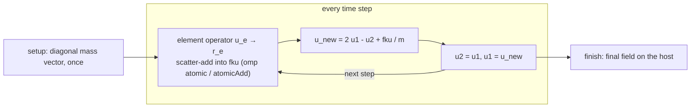
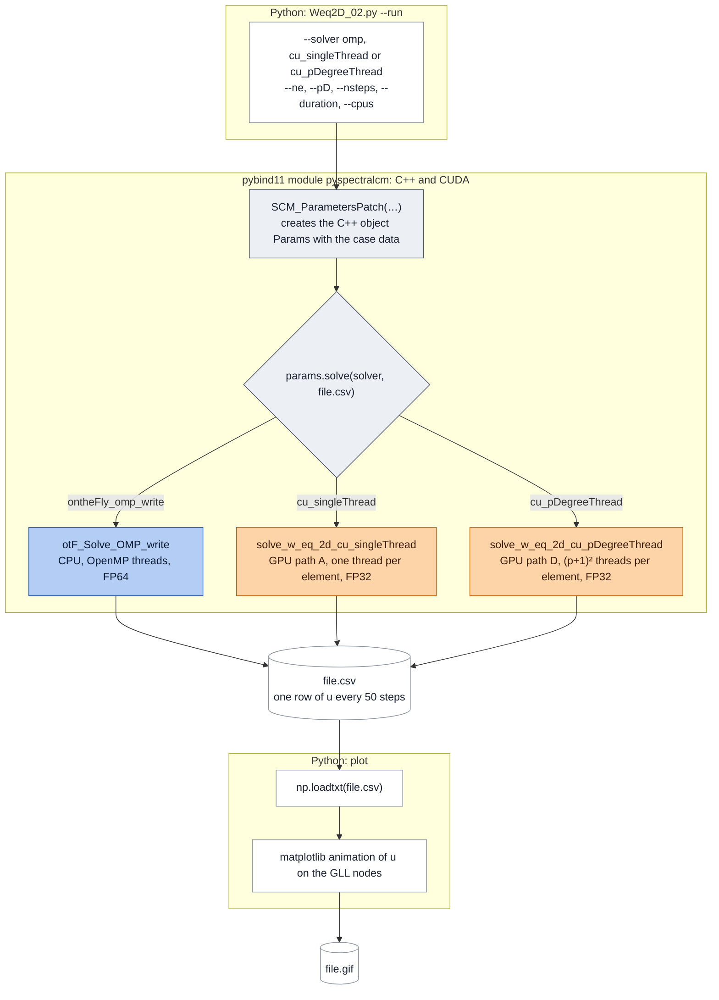

# 2D Wave Equation – Spectral Element Method


A matrix-free spectral element solver for the 2D scalar wave equation with explicit time stepping. No global matrix is ever assembled: in every time step the element stiffness operator is applied on the fly with sum factorization and the result is scattered into a global vector. The same algorithm runs on the CPU (C++/OpenMP, double precision) and on the GPU (CUDA, single precision). A Python layer built on pybind11 runs the simulations, benchmarks and plots.

| | |
|---|---|
| Problem | 2D scalar wave equation on $[0,2]^2$, $\rho = c = 1$, structured $n_e \times n_e$ mesh |
| Space | $C^0$ Lagrange elements of degree $p$ on GLL nodes, GLL quadrature |
| Time | central differences (CDM) with diagonal mass, $\Delta t = 0.9\,C_p\,h/c$ |
| Operator | sum-factorized element kernels after Algorithms 5.7, 8.2 and 8.4 of D'Angella [13] |
| Back-ends | `omp` (CPU, FP64), `cu_singleThread` and `cu_pDegreeThread` (GPU, FP32) |
| Languages | C++14, CUDA 12, Python ≥ 3.10 |

**Contents:** [Background](#background) · [Model and discretization](#model-and-discretization) · [Matrix-free operators](#matrix-free-operators) · [Implementations](#implementations) · [Layout](#repository-layout) · [Building](#building) · [Running](#running) · [Results](#results) · [Performance](#performance-headroom) · [Licence](#third-party-code-and-licence) · [Sources](#sources)

## Background

I wrote this code as a HiWi (student research assistant) at the [TUM Chair of Computing in Civil and Building Engineering](https://www.cee.ed.tum.de/en/ccbe/home/), supervised by Tim Bürchner. It started from Tim's Python spectral cell code, which used SciPy sparse matrices, quadtree integration of the cut cells around a circular hole, and explicit CDM. That code is not part of this repository.

From there I wrote a library-free Python version with the on-the-fly element operator, then a C++/OpenMP version (CMake, unit tests, pybind11, live visualisation with Catalyst), and finally the CUDA version in this repository. Roughly: C++/Python integration from September 2024, core C++ in January 2025, OpenMP in February, the first CUDA version in May and the faster `cu_pDegreeThread` in June 2025. In autumn 2026 I recovered the code from the university GitLab and cleaned it up for publication.

The next step is moment fitting for cut cells, so that the on-the-fly approach also works on domains with holes.

## Model and discretization

```math
\begin{array}{ccc}
\rho\,\ddot u-\nabla\cdot\left(\rho\,c^{2}\,\nabla u\right)=f(x,y,t)
& \xrightarrow{\ \text{Galerkin, GLL}\ } &
M\,\ddot{\hat u}+K\,\hat u=f_t(t)\,F
\\[4pt]
\text{in }\Omega=[0,2]^{2},\quad \nabla u\cdot\mathbf n=0\ \text{on }\partial\Omega,\quad u=\dot u=0\ \text{at }t=0
& &
M_{ij}=\int_{\Omega}\rho\,N_iN_j\,d\Omega,\quad
K_{ij}=\int_{\Omega}\rho c^{2}\,\nabla N_i\cdot\nabla N_j\,d\Omega,\quad
F_i=\int_{\Omega}N_i\,f_x\,d\Omega
\end{array}
```

The discretized system comes from the weak form with $u_h=\sum_j N_j\,\hat u_j(t)$; the boundary term drops because of the Neumann condition. The source is separable, $f(x,y,t)=f_x(x,y)\,f_t(t)$, with

```math
f_x(x,y)=10\,\exp\!\left(-\frac{x^{2}+y^{2}}{2\sigma_S^{2}}\right),\qquad
f_t(t)=-\frac{t-t_0}{\sqrt{2\pi}\,\sigma_T^{3}}\exp\!\left(-\frac{(t-t_0)^{2}}{2\sigma_T^{2}}\right),\qquad
t_0=\frac{1}{f_0},\quad \sigma_T=\frac{1}{2\pi f_0}
```

$M$, $K$ and $F$ are sums of element contributions $M_e$, $K_e$, $F_e$, each evaluated on the reference element with $d\Omega=\tfrac{h_x}{2}\tfrac{h_y}{2}\,dr\,ds$. With GLL quadrature $M$ is diagonal ($M_L$, see below). The [matrix-free operators](#matrix-free-operators) evaluate $K\hat u$ and $F$ without forming the matrices.

The values are set in [spectralcm.cpp](spectralcm/src/spectralcm.cpp#L87-L123): $\rho = c = 1$, $f_0 = 1$ Hz (so $t_0 = 1$ s, $\sigma_T \approx 0.159$ s) and $\sigma_S = 0.06$. The forms of $f_x$ and $f_t$ follow Faßbender [1, 2]; the domain, frequency and source position come from Tim's code.

A few things worth knowing about the setup:

- The source sits in the corner $(0,0)$ ([params.cpp](spectralcm/src/params.cpp#L213-L219)). Because all edges are reflecting, this is the same as one quadrant of the problem on $[-2,2]^2$ with the source in the centre.
- All four edges are homogeneous Neumann boundaries. There is no absorbing layer, so waves reflect.
- $f_t$ is the first derivative of a Gaussian. The original code calls it a Ricker wavelet, but a Ricker wavelet is the second derivative.
- The original problem has a hole of radius 0.4 at $(1,1)$. This code has no cut cells yet, so the hole is not simulated; the GIFs only draw its outline. `center` and `radius` are used for that drawing, and `E`, `alpha` and `domain` in [params.cpp](spectralcm/src/params.cpp#L8-L76) are stored but unused.

### Spatial discretization

Each element maps the reference square $r,s\in[-1,1]$ to $x=(i_e+r/2+1/2)\,h_x$, $y=(j_e+s/2+1/2)\,h_y$ with $h=L_d/n_e$ ([params.cpp](spectralcm/src/params.cpp#L207-L211)). The mesh always has the same number of elements in both directions; that kept the implementation simple.

The basis is the tensor product $N_{ab}(r,s)=\ell_a(r)\,\ell_b(s)$ of 1D Lagrange polynomials on the $p+1$ GLL nodes (the end points $\pm1$ and the roots of $P_p'$). Global node $(I,J)$ with $I=p\,i_e+a$, $J=p\,j_e+b$ gets index $g=I\,N_y+J$ with $N_y=n_e p+1$, which gives $N=(n_e p+1)^2$ degrees of freedom ([createLocationMap](spectralcm/src/params.cpp#L135-L146)).

Mass, stiffness and load all use GLL quadrature with $p+1$ points per direction. Since the quadrature points are the nodes, the element mass matrix is *diagonal*, $M_e=\rho\,\tfrac{h_x}{2}\tfrac{h_y}{2}\,(w\otimes w)$. GLL is exact only up to degree $2p-1$, so mass and stiffness are slightly under-integrated; this is the usual spectral element trade-off. The GLL nodes, weights and Lagrange basis come from *AdhoC++* (see [licence](#third-party-code-and-licence)).

**Spectral cells vs. spectral elements.** The spectral cell method [4, 1, 2] embeds the domain in a Cartesian grid and integrates cut cells with quadtrees; on uncut cells it reduces to the spectral element method [5, 6, 9]. Since this code has only uncut cells, it is a plain GLL spectral element method. One difference from [1, 2]: they integrate stiffness and load with Gauss–Legendre points, I use GLL points. This changes the critical time step.

### Time integration

The update is the central difference method with lumped mass:

```math
u^{n+1}=2u^{n}-u^{n-1}+\Delta t^{2}\,M_L^{-1}\left(f_t(t_{n+1})\,F-K\,u^{n}\right),\qquad n=1,\dots,N_t-1,\qquad u^{0}=u^{1}=0
```

The source is evaluated at $t_{n+1}$, one step ahead of $u^n$. Standard CDM uses $t_n$.

The simulation parameters come from earlier work by Tim and Faßbender [1, 2]; a stability study was not part of this project. Testing different meshes and polynomial degrees still needs a stable time step for each combination, so the code derives $\Delta t$ from the critical time step.

For CDM, $\Delta t_{crit}=2/\omega_{max}=C_p\,h/c$ [3]. [cp_table.py](python/scripts/dt_table/cp_table.py) computes $C_p$ from the element eigenproblem; [w_eq_2d_autostable](spectralcm/src/spectralcm.cpp#L87-L123) uses $\Delta t=0.9\,C_p\,h/c$. The $C_p$ table and the time-step study are in [cp_table_README.md](python/scripts/dt_table/cp_table_README.md).


## Matrix-free operators

$K$ and $M$ are never formed (compare [10]). In every step each element $e$ computes

```math
r_e=\Delta t^{2}\left(f_t(t)\,F_e-K_e\,u_e\right),\qquad
F_e=\int_{\Omega_e}N\,f_x\,d\Omega,\qquad
K_e\,u_e=\sum_{d=1}^{2}B_d^{\top}\,W\,B_d\,u_e
```

and adds $r_e$ to a global vector. With $n=p+1$ the element operators are Kronecker products of small $n\times n$ matrices, which sum factorization [7, 8] applies one direction at a time:

- $N_0$ holds the basis values at the quadrature points. At GLL points this is the identity.
- $N_1$ holds the basis derivatives, scaled by $2/h$.
- $B_1=N_1\otimes N_0$ and $B_2=N_0\otimes N_1$.
- $W=\rho c^2\tfrac{h_x}{2}\tfrac{h_y}{2}(w\otimes w)$ is called `M` in the code, and $G=\rho\tfrac{h_x}{2}\tfrac{h_y}{2}(w\otimes w)$ is called `G`.

The kernels follow D'Angella's dissertation [13] ("Davide's Diss" in the code), where Algorithms 8.2 and 8.4 are element-local versions of Sangalli and Tani's algorithms:

| Function | What it does | Cost in 2D |
|---|---|---|
| `alg_57` | applies $R_1\otimes R_2$ to $n^2$ values: two sweeps of $n$ small mat-vecs | $2n^3$ multiply-adds |
| `alg_82` | mass-type operator $B^{\top}G\,B\,v$: 2 × `alg_57` plus scaling | about $8n^3$ flops |
| `alg_84` | stiffness operator $\sum_d B_d^{\top}W B_d\,v$: 4 × `alg_57` plus scaling | about $16n^3$ flops |

`alg_84` only needs 4 Kronecker products instead of the general 6 because the elements are axis-aligned and the material is isotropic, so the mixed terms vanish ([13], p. 120). Per element and step that adds up to about $24(p+1)^3$ flops plus $(p+1)^2$ exponentials, against $2(p+1)^4$ for a dense element mat-vec.

The diagonal mass is `alg_82` applied to a vector of ones, computed once ([compute_Mass_Cvector_OMP](spectralcm/src/ontheFly.cpp#L262-L286), [solve_Mass_singleThread](cuda_spectral/src/cuontheFly.cu#L1283-L1312)). This only works because all elements are uncut.

<!-- > [!NOTE] Leave it here for next implementation. 
> **Optimization potential.** $N_0$ is the identity at GLL points, so half of the work in `alg_57` multiplies by an identity matrix. $F_e=G\circ f_x$ does not depend on time and is recomputed in every step. Using both facts would cut the work to about $8(p+1)^3$ flops per element (derivative sweeps only). -->

## Implementations

All three solvers run the same loop: compute the diagonal mass once, then in every step apply the element operator with a scatter-add, update $u$, and shift the time levels. The CPU does each stage as an OpenMP loop; the GPU launches one kernel per stage.



### CPU (C++/OpenMP, FP64)

The CPU solver is the class `ontheFly` ([ontheFly.cpp](spectralcm/src/ontheFly.cpp)). The loop everyone uses is [otF_Solve_OMP_write](spectralcm/src/ontheFly.cpp#L122-L154): Python (`--solver omp`), `benchmark_solver` and the OpenMP driver all call it. It keeps only two time levels, runs [compute_fKu_Cvector_OMP](spectralcm/src/ontheFly.cpp#L218-L237) (`parallel for collapse(2)` over elements with an atomic scatter) and optionally appends `u` to a CSV every 50 steps.

There are two older loops, [otF_Solve](spectralcm/src/ontheFly.cpp#L83-L100) (serial, used by the unit tests) and [otF_Solve_OMP](spectralcm/src/ontheFly.cpp#L101-L121). Both store every time step, which is 9.9 GB at 80×80, $p=4$, 12,000 steps, so only use them for small runs.

### GPU (CUDA, FP32)

The two GPU versions share setup, update kernels and teardown. They differ only in the element kernel:

- **`cu_singleThread`** – [solve_fKu_singleThread](cuda_spectral/src/cuontheFly.cu#L1040-L1090) runs `<<<n_elements, 1>>>`: one thread per element, running device ports of the CPU algorithms.
- **`cu_pDegreeThread`** – [solve_fKu_pDegreeThread](cuda_spectral/src/cuontheFly.cu#L1093-L1148) runs `<<<n_elements, (p+1)^2>>>`: one block per element and one thread per node, with the element data in shared memory and `atomicAdd` into the global vector.

The GPU code supports $p \le 5$ (the CPU goes up to 10). The limit is `MAX_pD` in [cuontheFly.cuh](cuda_spectral/inc/cuontheFly.cuh#L34), which sizes the fixed shared and local arrays. To go higher, raise it, rebuild, and lift the $p \le 5$ checks in `Weq2D_02.py` and `benchmark_solver.py`.

Both GPU versions are tested against the CPU for $p = 2\dots5$. The entry points, naming scheme and a per-function overview are in [cuda_spectral/solver.md](cuda_spectral/solver.md).

The CPU computes in `double`. The GPU drivers use `float`, and most CUDA templates are only instantiated for `float`.

### Python

- `pyspectralcm` ([spectralcm_python.cpp](python/bindings/spectralcm_python.cpp)) exposes `SCM_ParametersPatch(...)`. Its `.solve(solver, filename)` takes `ontheFly`, `ontheFly_omp`, `ontheFly_omp_write`, `cu_singleThread` or `cu_pDegreeThread`.
- [Weq2D_02.py](python/scripts/Weq2D_02.py) runs (or re-reads) one simulation and renders a GIF.
- [benchmark_solver.py](python/scripts/benchmark_solver.py) runs the `benchmark_solver` executable over a set of configurations and writes the timings to a CSV.
- [cp_table.py](python/scripts/dt_table/cp_table.py) computes the $C_p$ table.

A run of `Weq2D_02.py --run` goes through the module like this: Python sets up the case and picks the solver, C++ or CUDA computes and writes the CSV, and Python reads the CSV back and draws the GIF.



## Repository layout

```text
SCM_cuda/
├── libs/            linalg (dense Matrix), numeric (GLL + Lagrange, AdhoC++), culib (timers, error handling, GPU helpers)
├── spectralcm/      CPU library: problem setup, basis, source, on-the-fly operators, OpenMP loop (+ 17 tests)
├── cuda_spectral/   CUDA library: both kernel versions and host loops (+ 24 tests), solver.md
├── drivers/         small demos: 5×5 OpenMP and CUDA runs, GPU check
├── roofline/        benchmark_solver (whole simulation) and micro-benchmarks for single kernels/sections
├── python/          pybind11 bindings and scripts (runs, benchmarks, GIFs, C_p table)
├── vendor/          Catch v2.13.9, pybind11 2.10.0.dev1
└── results/         benchmark and accuracy studies
```

## Building

Tested in a dev container based on `nvidia/cuda:12.4.1-devel-ubuntu22.04` with CMake 3.22 (≥ 3.18 required), GCC 11.4, CUDA 12.4, Python 3.10 (numpy, matplotlib), `libcli11-dev` and OpenMP.

```bash
cmake -S . -B build -DCMAKE_BUILD_TYPE=Release ## for building withtout cuda -DENABLE_CUDA=OFF
cmake --build build -j"$(nproc)"
cmake --install build      # test runners → build/install/bin/, libraries, Python module and scripts → build/install/lib/
```

- CMake asks `nvidia-smi` for the GPU architecture. Without a visible GPU it builds for a list of common ones; override with `-DSCM_CUDA_ARCH="70;80"`.
- Without a CUDA toolkit (or with `-DSPECTRAL_USE_CUDA=OFF`) only the CPU parts are built. `BUILD_TESTING`, `BUILD_PYTHON` and `BUILD_BENCHMARKS` are on by default.
- If a run fails with `forward compatibility was attempted on non supported HW`, the container's CUDA compat library is shadowing the driver: `export LD_LIBRARY_PATH=/lib/x86_64-linux-gnu`.

## Running

```bash
B=build/roofline
$B/benchmark_solver -d cu_pDegreeThread -n 20 -p 4 --nsteps 1000 --num_reps 10   # mean time of one full solve [s]
$B/benchmark_solver -d omp -n 20 -p 4 -t 4 --nsteps 1000 --num_reps 10
$B/benchmark_solver -d cu_pDegreeThread -n 10 -p 5 --num_reps 1 --verify 1       # compare against omp
```

`-d` picks the device (`omp`, `cu_singleThread`, `cu_pDegreeThread`), `-n` the elements per direction, `-p` the degree and `-t` the OpenMP threads. `--warmup` and `--stats` follow the benchmarking advice of [12], `--filename` writes the final field, and `benchmark_solver --help` lists the rest. The timing covers the whole solve: allocation, mass vector, time loop and, on the GPU, the copy back. Since the number of steps is fixed (1000 by default) and $\Delta t$ follows from the mesh, the simulated time ranges from 104 s (5×5, $p=2$) to 2.35 s (80×80, $p=4$): fine for cost per step, not for comparing accuracy across meshes.

```bash
python3 python/scripts/benchmark_solver.py --run --solver omp cu_pDegreeThread --ne 20 80 --pD 2 3 4 --cpus 1 4 --reps 10 --filename sweep.csv
cd build/install/lib && python3 Weq2D_02.py --run --solver omp --ne 20 --pD 4 --nsteps 2000 --duration 12
```

Tests:

```bash
./build/install/bin/spectralcm_testrunner
./build/install/bin/spectralcu_testrunner
./build/install/bin/linalg_testrunner
```

## Results

todo: update

Each experiment in [results/](results/) has its own report; [results.md](results/results.md) lists them with date and machine.

- [solver_comparison](results/solver_comparison/solver_comparison.md): run time of `omp` (1, 4, 8 threads) vs `cu_pDegreeThread`, 1000 steps, $n_e$ = 5…80, $p$ = 2…4. These numbers are from after I fixed a full copy of the solution vector in the CPU solver; the earlier ones overstated the GPU speed-up on large meshes.
- [case_pD4_12000stp_12s](results/case_pD4_12000stp_12s/case.md): accuracy of both GPU versions (FP32) against `omp` (FP64) over 12 s, $p=4$, $n_e$ = 20, 40, 80.

## Performance headroom

todo: update

Rough estimates based on $24(p+1)^3$ flops per element and step:

| Back-end | Case | Measured | Achieved | Peak | Fraction |
|---|---|---|---|---|---|
| OpenMP, 1 thread | $p=4$ | 17.8 µs per element-step | about 0.18 GFLOP/s | about 56 GFLOP/s FP64 per core | about 0.3 % |
| `cu_pDegreeThread` | 80×80, $p=4$ | 7.52 ms per step | about 2.7 GFLOP/s | about 1,400 GFLOP/s FP32 | about 0.2 % |

Both are far from what the hardware can do. On the CPU most of the time goes into memory allocation and copies inside the element loop. On the GPU most threads sit idle: only $p+1$ of the $(p+1)^2$ threads work in each sweep, and for $p\le4$ a block is a single, partly filled warp.

What I would try next, roughly in order of expected gain:

1. CPU: remove allocations and copies from the element loop, precompute $F_e$, skip the identity sweeps.
2. GPU: put several elements in one block, keep all threads busy in every sweep, skip the identity sweeps.
3. GPU, smaller things: constant memory for $B$, $B_{diff}$, $W$; pointer swaps instead of the rotate kernel; no `cudaDeviceSynchronize` every step.
4. Compare CPU and GPU in the same precision.

## Third-party code and licence

My code is MIT-licensed ([LICENSE](LICENSE)). The exceptions:

| Component | Location | Origin | Licence |
|---|---|---|---|
| GLL table, Lagrange basis | `libs/numeric/` | AdhoC++, Chair for Computation in Engineering, TUM | all rights reserved, used with permission |
| `linalg`, project skeleton | `libs/linalg`, `basisfunctions.*`, CMake layout | TUM course Computation in Engineering I | not stated |
| GPU/benchmark helpers | `types.hpp`, `timers.hpp`, `error_handling.hpp`, `test_helpers.hpp`, `linalg.cuh`, `roofline/` | same course | not stated; Ginkgo macros in `types.hpp` are BSD-3-Clause |
| Catch | `vendor/catch` | Catch2 v2.13.9 | BSL-1.0 |
| pybind11 | `vendor/pybind11` | pybind11 2.10.0.dev1 | BSD-3-Clause |
| CLI11 | system package | CLI11 | BSD-3-Clause |

The AdhoC++ files keep their original copyright header and may not be reused outside this project without the Chair's permission. Full notices are in [THIRD_PARTY_NOTICES.md](THIRD_PARTY_NOTICES.md); to cite this software, see [CITATION.cff](CITATION.cff).

## Sources

- **[1]** C. Faßbender, *Time Integration for the Spectral Cell Method with Application to the Full Waveform Inversion*, MSc thesis, TUM, 2023.
- **[2]** C. Faßbender, T. Bürchner, P. Kopp, E. Rank, S. Kollmannsberger, *Implicit-explicit time integration for the immersed wave equation*, Comput. Math. Appl. 163 (2024) 1–13, doi:10.1016/j.camwa.2024.02.049.
- **[3]** T. J. R. Hughes, *The Finite Element Method: Linear Static and Dynamic Finite Element Analysis*, Dover, 2000.
- **[4]** M. Joulaian, S. Duczek, U. Gabbert, A. Düster, *Finite and spectral cell method for wave propagation in heterogeneous materials*, Comput. Mech. 54 (2014) 661–675.
- **[5]** A. T. Patera, *A spectral element method for fluid dynamics: laminar flow in a channel expansion*, J. Comput. Phys. 54 (1984) 468–488.
- **[6]** D. Komatitsch, J. Tromp, *Introduction to the spectral element method for three-dimensional seismic wave propagation*, Geophys. J. Int. 139 (1999) 806–822.
- **[7]** S. A. Orszag, *Spectral methods for problems in complex geometries*, J. Comput. Phys. 37 (1980) 70–92.
- **[8]** M. O. Deville, P. F. Fischer, E. H. Mund, *High-Order Methods for Incompressible Fluid Flow*, Cambridge University Press, 2002.
- **[9]** G. Karniadakis, S. Sherwin, *Spectral/hp Element Methods for Computational Fluid Dynamics*, 2nd ed., Oxford University Press, 2005.
- **[10]** M. Kronbichler, K. Kormann, *A generic interface for parallel cell-based finite element operator application*, Comput. Fluids 63 (2012) 135–147.
- **[11]** S. Williams, A. Waterman, D. Patterson, *Roofline: an insightful visual performance model for multicore architectures*, Commun. ACM 52(4) (2009) 65–76.
- **[12]** T. Hoefler, R. Belli, *Scientific benchmarking of parallel computing systems: twelve ways to tell the masses when reporting performance results*, SC '15, 2015.
- **[13]** D. D'Angella, *The multi-level Bézier extraction for hierarchical local refinement of trimmed isogeometric finite cell analyses*, Dr.-Ing. dissertation, Technische Universität München, 2022.