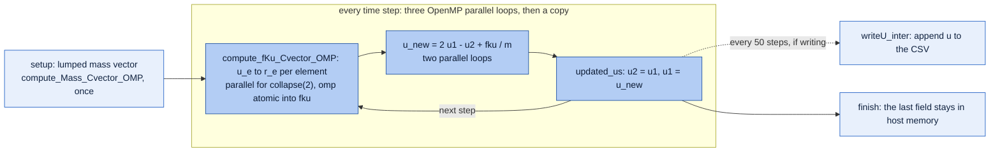
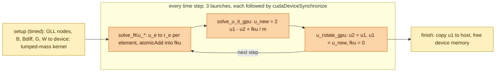
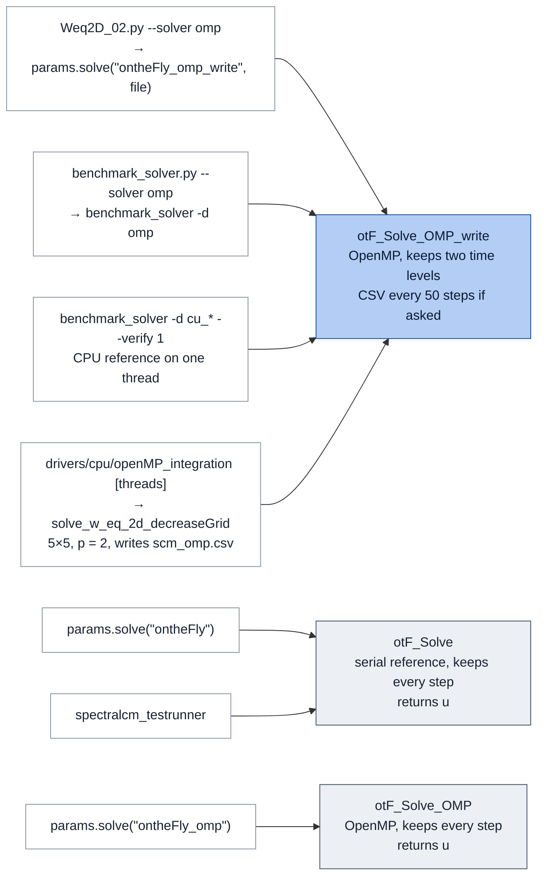
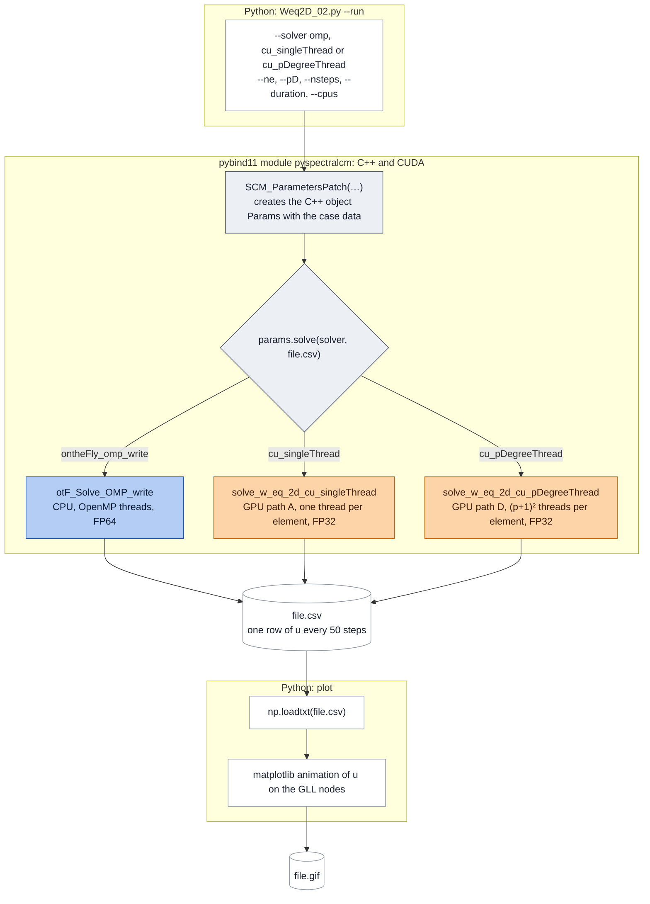

# 2D Wave Equation – Spectral Element Method


This repository solves the 2-dimensional scalar wave equation with high-order spectral elements and explicit time stepping. It never assembles a global matrix. Every time step it evaluates the element stiffness operator "on the fly" with sum factorization and scatters the result into a global vector. The same algorithm runs as a multithreaded C++ solver (OpenMP, double precision) and as CUDA kernels (single precision). A Python layer (pybind11 and scripts) drives runs, benchmarks and plots.

| | |
|---|---|
| Equation | 2D scalar wave equation, homogeneous medium ($\rho = 1$, $c = 1$) |
| Domain | $[0,2]^2$, structured $n_e \times n_e$ mesh, no cut cells |
| Space | $C^0$ Lagrange elements of degree $p$ on Gauss–Lobatto–Legendre (GLL) nodes; GLL quadrature for mass, stiffness and load |
| Time | explicit central differences (CDM) with diagonal (lumped) mass; $\Delta t = 0.9\,C_p\,h/c$ |
| Operator | matrix-free, sum-factorized element kernels (Algorithms 5.7, 8.2 and 8.4 of D'Angella's dissertation [13]) |
| Back-ends | `omp` (C++/OpenMP, FP64); `singleThread` (one thread per element, FP32; `benchmark_solver -d cu_singleThread`); `pDegreeThread` (one thread block of $(p+1)^2$ threads per element, FP32; `-d cu_pDegreeThread`) |
| Languages | C++14, CUDA 12, Python ≥ 3.10 |
| Author | Eduardo Quintana Diaz, HiWi project, supervisor Tim Bürchner |

## Contents

1. [Context and history](#1-context-and-history)
2. [Mathematical model](#2-mathematical-model)
3. [Spatial discretization](#3-spatial-discretization)
4. [Matrix-free operators](#4-matrix-free-operators-sum-factorization)
5. [Time integration and stability](#5-time-integration-and-stability)
6. [Implementations](#6-implementations)
7. [Repository layout](#7-repository-layout)
8. [Building](#8-building)
9. [Running](#9-running)
10. [Results](#10-results)
11. [Performance headroom](#11-performance-headroom)
12. [Third-party code, provenance and licence](#12-third-party-code-provenance-and-licence)
13. [Sources](#sources)

---

## 1. Context and history

This code was written during a HiWi (student research assistant) position at the [TUM's Chair of Computing in Civil and Building Engineering ](https://www.cee.ed.tum.de/en/ccbe/home/), supervised by Tim Bürchner. It continues the Python spectral cell code that Tim provided.

The work went through five stages:
1. Tim's Python code: sparse matrices (SciPy), quadtree integration of cut cells around a circular hole, explicit CDM. Not included in this repository.
2. A library-independent Python version that introduced the on-the-fly element operator.
3. C++ with OpenMP: a CMake project with unit tests, pybind11, and live visualisation with Catalyst.
4. CUDA: this repository.
5. Moment fitting for cut cells (in progress).

Timeline: September 2024 start (C++/Python integration), January 2025 core C++, February 2025 OpenMP, May 2025 first CUDA version, June 2025 faster CUDA version (`cu_pDegreeThread`). In September and October 2026 the code was recovered from the university GitLab and prepared for publication.

Development continues: moment fitting for cut cells will keep the on-the-fly algorithm usable when the domain has holes.

## 2. Mathematical model

```math
\rho\,\ddot u-\nabla\cdot\left(\rho\,c^{2}\,\nabla u\right)=f(x,y,t)\quad\text{in }\Omega=[0,2]^{2},\qquad
\nabla u\cdot\mathbf n=0\ \text{on }\partial\Omega,\qquad u=\dot u=0\ \text{at }t=0
```

The source is separable, $f(x,y,t)=f_x(x,y)\,f_t(t)$, with

```math
f_x(x,y)=10\,\exp\!\left(-\frac{x^{2}+y^{2}}{2\sigma_S^{2}}\right),\qquad
f_t(t)=-\frac{t-t_0}{\sqrt{2\pi}\,\sigma_T^{3}}\exp\!\left(-\frac{(t-t_0)^{2}}{2\sigma_T^{2}}\right),\qquad
t_0=\frac{1}{f_0},\quad \sigma_T=\frac{1}{2\pi f_0}
```

| Parameter | Value | Set in |
|---|---|---|
| $\rho$, $c$ | 1, 1 | [spectralcm.cpp](spectralcm/src/spectralcm.cpp#L87-L123) |
| $f_0$ | 1 Hz, so $t_0 = 1$ s and $\sigma_T \approx 0.159$ s | same |
| $\sigma_S$ | 0.06 | same |
| Domain size | 2 × 2 | same |
| `E`, `alpha`, `domain` | stored, never used | [params.cpp](spectralcm/src/params.cpp#L8-L76) |
| `center`, `radius` | (1, 1), 0.4; only used to draw a circle in the GIFs | same |

Additional information about the simulation:

- **Source location.** $f_x$ is centred at the corner $(0,0)$ ([params.cpp:213](spectralcm/src/params.cpp#L213-L219)). With reflecting boundaries this equals, by symmetry, one quarter of a centred source in a $[0,2]^2$ domain.
- **No hole.** The original problem has a void of radius 0.4 at $(1,1)$. This code simulates only uncut cells, so the void is absent. The GIFs still draw its outline for future implementation. 
- **Wavelet.** $f_t$ is the first derivative of a Gaussian. The reference code calls it a Ricker wavelet, which is the second derivative.
- **Boundaries.** All four edges are natural (homogeneous Neumann) boundaries, so waves reflect. There is no absorbing layer.

## 3. Spatial discretization

- **Reference element.** $r,s\in[-1,1]$, mapped by $x=(i_e+r/2+1/2)\,h_x$ and $y=(j_e+s/2+1/2)\,h_y$ with $h=2/n_e$ ([params.cpp:207](spectralcm/src/params.cpp#L207-L211)).
- **Basis.** One-dimensional Lagrange polynomials $\ell_a$ on the $p+1$ GLL nodes $\xi_a$ (the end points $\pm1$ and the roots of $P_p'$). The 2D basis is the tensor product $N_{ab}(r,s)=\ell_a(r)\,\ell_b(s)$, with $(p+1)^2$ nodes per element.
- **Global numbering.** Node $(I,J)$ with $I=p\,i_e+a$ and $J=p\,j_e+b$ gets index $g=I\,N_y+J$, where $N_y=n_e p+1$. The mesh has $N=(n_e p+1)^2$ degrees of freedom ([createLocationMap](spectralcm/src/params.cpp#L135-L146)).
- **Quadrature.** GLL with $p+1$ points per direction for mass, stiffness and load. Quadrature points coincide with nodes, so the mass matrix is exactly diagonal: $M_e=\rho\,\tfrac{h_x}{2}\tfrac{h_y}{2}\,(w\otimes w)$. GLL is exact up to degree $2p-1$, so the stiffness and mass are slightly under-integrated in the cross direction. This is the classical spectral element choice. The GLL nodes and weights and the Lagrange basis come from the AdhoC++ library of the Chair for Computation in Engineering, TUM (see [§12](#12-third-party-code-provenance-and-licence)). 
- **Same number of elements in both directions.** The mesh is always $n_e \times n_e$. This was a design decision from the start of the project for simplifying the implementation.

**Relation to the spectral cell method.** The spectral cell method (SCM) [4, 1, 2] embeds the physical domain in a Cartesian grid and integrates cut cells with quadtrees. On uncut cells it reduces to the spectral element method (SEM) [5, 6, 9]. This repository has only uncut cells, so mathematically it is a GLL spectral element method. One more difference: [1, 2] integrate the stiffness and load vector of uncut cells with Gauss–Legendre points, while this code uses GLL points. That changes the critical time step (§5).

**Semi-discrete system.** Multiplying by a test function, integrating by parts and inserting $u_h(\mathbf x,t)=\sum_j N_j(\mathbf x)\,\hat u_j(t)$ gives (the boundary integral vanishes because of the homogeneous Neumann condition)

```math
M\,\ddot{\hat{u}}(t)+K\,\hat u(t)=f_t(t)\,F,
\qquad
M_{ij}=\int_{\Omega}\rho\,N_iN_j\,d\Omega,\quad
K_{ij}=\int_{\Omega}\rho c^{2}\,\nabla N_i\cdot\nabla N_j\,d\Omega,\quad
F_i=\int_{\Omega}N_i\,f_x\,d\Omega
```

$M$, $K$ and $F$ are sums of element contributions $M_e$, $K_e$, $F_e$, each evaluated on the reference element with $d\Omega=\tfrac{h_x}{2}\tfrac{h_y}{2}\,dr\,ds$. With GLL quadrature $M$ is diagonal ($M_L$, see Quadrature above); §4 evaluates $K\hat u$ and $F$ without forming the matrices, and §5 integrates the system in time.


## 4. Matrix-free operators

The code never forms $K$ or $M$ (a matrix-free method, compare [10]). In every step, for every element $e$, it computes

```math
r_e=\Delta t^{2}\left(f_t(t)\,F_e-K_e\,u_e\right),\qquad
F_e=\int_{\Omega_e}N\,f_x\,d\Omega,\qquad
K_e\,u_e=\sum_{d=1}^{2}B_d^{\top}\,W\,B_d\,u_e
```

and adds $r_e$ into a global vector (scatter-add). With $n=p+1$, the element operators are Kronecker products of small $n\times n$ matrices, which sum factorization [7, 8] applies one direction at a time:

- $N_0$: basis values at the quadrature points (the identity matrix here, because points and nodes coincide),
- $N_1$: basis derivatives at the quadrature points, scaled by $2/h$,
- $B_1=N_1\otimes N_0$ and $B_2=N_0\otimes N_1$,
- $W=\rho c^2\tfrac{h_x}{2}\tfrac{h_y}{2}(w\otimes w)$ (called `M` in the code) and $G=\rho\tfrac{h_x}{2}\tfrac{h_y}{2}(w\otimes w)$ (called `G`).

The three kernels follow algorithms numbered 5.7, 8.2 and 8.4 in D. D'Angella's dissertation [13] (called "Davide's Diss" in the code):

| Function | Purpose | How | Cost in 2D |
|---|---|---|---|
| `alg_57` | apply a Kronecker product $R_1\otimes R_2$ to $n^2$ values | two sweeps of $n$ small $n\times n$ mat-vecs | $2n^3$ flops |
| `alg_82` | mass-type operator $v\mapsto B^{\top}G\,B\,v$ | 2 × `alg_57` plus pointwise scaling | about $8n^3$ flops |
| `alg_84` | stiffness operator $v\mapsto\sum_d B_d^{\top}W B_d\,v$ | 4 × `alg_57` plus scaling | about $16n^3$ flops |

Per element and step the code runs `alg_84` on $u_e$ and `alg_82` on the source values. That is about $24(p+1)^3$ flops plus $(p+1)^2$ exponentials. A dense element matrix would cost $2(p+1)^4$ flops per product. 

The lumped mass vector is `alg_82` applied to a vector of ones, assembled once ([compute_Mass_Cvector_OMP](spectralcm/src/ontheFly.cpp#L262-L286), [solve_Mass_singleThread](cuda_spectral/src/cuontheFly.cu#L1283-L1312)). This particular characteristic only holds for uncut elements, thus, the implementation up to this date contains a fully diagonal matrix treated as a vector. 

<!-- > [!NOTE] Leave it here for next implementation. 
> **Optimization potential.** $N_0$ is the identity at GLL points, so half of the work in `alg_57` multiplies by an identity matrix. $F_e=G\circ f_x$ does not depend on time and is recomputed in every step. Using both facts would cut the work to about $8(p+1)^3$ flops per element (derivative sweeps only). -->

## 5. Time integration and stability

The update is the central difference method with lumped mass:

```math
u^{n+1}=2u^{n}-u^{n-1}+\Delta t^{2}\,M_L^{-1}\left(f_t(t_{n+1})\,F-K\,u^{n}\right),\qquad n=1,\dots,N_t-1,\qquad u^{0}=u^{1}=0
```

The source is evaluated at $t_{n+1}$, one step ahead of $u^n$. Standard CDM uses $t_n$. 


### 5.1 Stability

The simulation parameters come from earlier work by Tim and Faßbender [1, 2]; a stability study was not part of this project. Testing different meshes and polynomial degrees still needs a stable time step for each combination, so the code derives $\Delta t$ from the critical time step.

For CDM, $\Delta t_{crit}=2/\omega_{max}=C_p\,h/c$ [3]. [cp_table.py](python/scripts/dt_table/cp_table.py) computes $C_p$ from the element eigenproblem; [w_eq_2d_autostable](spectralcm/src/spectralcm.cpp#L87-L123) uses $\Delta t=0.9\,C_p\,h/c$.

| $p$ | $C_p$, this code (GLL mass, GLL stiffness) | $C_p$, thesis/paper rule (GLL mass, Gauss–Legendre stiffness) |
|---|---|---|
| 1 | 0.7071 | 1.0000 |
| 2 | 0.2887 | 0.3727 |
| 3 | 0.1641 | 0.1826 |
| 4 | 0.1044 | 0.1084 |
| 5 | 0.0714 | 0.0725 |

The time-step study in [python/scripts/dt_table/](python/scripts/dt_table/) confirms the first column for $p=2$. On the 20×20 mesh, runs stay bounded at $\Delta t\,c/h=0.2844$ and diverge at $0.2927$. The 40×40 runs are consistent with the same limit. The prediction is $0.2887$, and the growth rates of the diverging runs give $C_2=0.2884\pm0.0003$. Only $p=2$ has been bracketed.

**Simulated time.** `benchmark_solver` fixes the number of steps (default 1000) and derives $\Delta t$ from the mesh. The simulated time $T=N_t\,\Delta t$ therefore ranges from 104 s (5×5, $p=2$) down to 2.35 s (80×80, $p=4$). That is fine for cost per step, but not for comparing accuracy across meshes.


## 6. Implementations

There are three solvers: `omp` on the CPU, and `cu_singleThread` and `cu_pDegreeThread` on the GPU.

<!-- The two CUDA versions differ in one kernel only: the element operator `solve_fKu_*`, which runs every time step. Setup, the update kernels and teardown are the same code for both ([solver.md](cuda_spectral/solver.md)). There are four ways into the GPU code. Paths A and D are one host function each and are what `Params::solve` and `Weq2D_02.py` run. Paths B and C split setup, time loop and teardown into three calls so that `benchmark_solver` can time them. A and B run the single-thread kernel, C and D the threaded one.

Which command runs which path, the diagrams, the naming rule (`singleThread`, `pDegreeThread`, `gpu`, `cu_`), every function by version and the CPU references in `cubase` are in [cuda_spectral/solver.md](cuda_spectral/solver.md). Both GPU versions are checked against the CPU by the unit tests for $p = 2\dots5$ (§9) and by the case study (§10). -->

**Polynomial degree.** The GPU code supports $p \le 5$; the CPU solver goes up to $p = 10$. The limit is the constant `MAX_pD` in [cuontheFly.cuh](cuda_spectral/inc/cuontheFly.cuh), which sizes the fixed shared and local arrays of the kernels. Five was chosen because no test or study so far needed a higher degree. Every GPU entry point checks the degree and stops with an error for larger $p$. Higher degrees are easy to add: raise `MAX_pD` and rebuild (shared memory per block grows with $(p+1)^2$), and lift the matching $p \le 5$ check in `Weq2D_02.py` and `benchmark_solver.py`.

**One run, stage by stage.** CPU and GPU run the same loop: the lumped mass vector once, then in every step the element operator with a scatter-add into a global vector, the update, and the shift of the time levels. The CPU runs each stage as an OpenMP loop over shared memory; the GPU launches one kernel per stage.

CPU, `omp` (`otF_Solve_OMP_write`, §6.1):



GPU, both versions (only `solve_fKu_*` differs; §6.2):



Light shade: runs once. Strong shade: runs every time step. Blue: CPU (OpenMP); yellow and orange: GPU.

The two CUDA versions differ in one kernel only: the element operator `solve_fKu_*`, which runs every time step. Setup, the update kernels and teardown are the same code for both. There are four ways into the GPU code ([solver.md](cuda_spectral/solver.md)). 

This project defined a naming rule (`singleThread`, `pDegreeThread`, `gpu`, `cu_`), every function owned by the GPU based on the version are in [cuda_spectral/solver.md](cuda_spectral/solver.md). Both GPU versions are checked against the CPU by the unit tests for $p = 2\dots5$ (§9) and by the case study (§10).

### 6.1 CPU: C++ and OpenMP, double precision

The CPU solver is the class `ontheFly` ([ontheFly.cpp](spectralcm/src/ontheFly.cpp)). It has three time loops:

- `otF_Solve_OMP_write` ([ontheFly.cpp:122](spectralcm/src/ontheFly.cpp#L122-L154)) is the one in use: Python (`--solver omp`), `benchmark_solver` and the OpenMP driver all run it. It keeps only the last two time levels. Each step runs [compute_fKu_Cvector_OMP](spectralcm/src/ontheFly.cpp#L218-L237), a `#pragma omp parallel for collapse(2)` loop over elements with `#pragma omp atomic` scatter, followed by two parallel loops (divide by the mass, update). Given a file name, it appends `u` to a CSV every 50 steps.
- `otF_Solve` ([ontheFly.cpp:83](spectralcm/src/ontheFly.cpp#L83-L100)) is the serial reference, used by `params.solve("ontheFly")` and the unit tests. It stores every step, $(N_t+1)\,N$ doubles, which is 9.9 GB at 80×80, $p=4$ and 12,000 steps. Use it only for small runs.
- `otF_Solve_OMP` ([ontheFly.cpp:101](spectralcm/src/ontheFly.cpp#L101-L121)), used by `params.solve("ontheFly_omp")`, is the OpenMP version of `otF_Solve`: it also stores every step and returns it. No script in the repository uses it.

Which command reaches which loop:



Blue: the loop in use. Grey: the two loops that keep every step and return it; use them only for small runs.

`roofline` ([roofline/openmp/roofline_spectral.cpp](roofline/openmp/roofline_spectral.cpp)) times single CPU sections (the fKu loop and the mass vector); it does not run a whole simulation.

### 6.2 GPU: CUDA, single precision

The GPU solver comes in two versions. Both run as the device `-d cu_*` of `benchmark_solver` and as `params.solve("cu_*")` from Python, where `*` is `singleThread` or `pDegreeThread`:

- **`cu_singleThread`**: [solve_fKu_singleThread](cuda_spectral/src/cuontheFly.cu#L1040-L1090) is launched as `<<<n_elements, 1>>>`, one block of one thread per element. The thread runs device ports of the CPU algorithms with per-thread arrays.
- **`cu_pDegreeThread`**: [solve_fKu_pDegreeThread](cuda_spectral/src/cuontheFly.cu#L1093-L1148) is launched as `<<<n_elements, (p+1)^2>>>`, one block per element and one thread per element node. Element data lives in fixed-size shared arrays (`MAX_pD = 5`, [cuontheFly.cuh:34](cuda_spectral/inc/cuontheFly.cuh#L34)). Thread $t$ evaluates the source at node $t$. Results are added into the global vector with `atomicAdd`.

[cuda_spectral/solver.md](cuda_spectral/solver.md) shows the four GPU paths, which command runs which, every function of each version, and how each version gets its scratch memory.

### 6.3 Precision

The CPU computes in `double`. The GPU drivers set `using ValueType = float`, and most CUDA templates are instantiated only for `float`. Both CSV writers print 8 significant digits.

### 6.4 Python layer

- The pybind11 module `pyspectralcm` ([spectralcm_python.cpp](python/bindings/spectralcm_python.cpp)) exposes `SCM_ParametersPatch(nelements, lengths, center, E, rho, domain, alpha, c, duration, radius, freq, sigmaS, nsteps, polDegree)`. Its `.solve(solver, filename)` accepts `ontheFly`, `ontheFly_omp`, `ontheFly_omp_write`, `cu_singleThread` (path A) and `cu_pDegreeThread` (path D). `ontheFly_omp_write` and the two CUDA strings append `u` to the CSV every `samplingFrecuency` steps (50) and return an empty matrix; `ontheFly` and `ontheFly_omp` return every step as a matrix (§6.1). An unknown string raises a `ValueError` that lists the valid names; in a CPU-only build the two `cu_` strings raise a `RuntimeError`.
- [benchmark_solver.py](python/scripts/benchmark_solver.py) is the benchmark runner. It calls the `benchmark_solver` executable (not the Python module) once per configuration and writes one CSV of timings, plus the final field of each run.
- [Weq2D_02.py](python/scripts/Weq2D_02.py) runs or re-reads one simulation and renders a GIF: `--solver omp`, `cu_singleThread` or `cu_pDegreeThread`. With `--quiet` the C++ output goes to `<name>.log` instead of the terminal.
- [cp_table.py](python/scripts/dt_table/cp_table.py) computes the $C_p$ table.

How a run of `Weq2D_02.py --run` goes through the module: Python sets up the case and chooses the solver, C++ or CUDA computes and writes the CSV, and Python reads the CSV back and draws the GIF.



## 7. Repository layout

The folders follow the layout: first-party libraries in `libs/`, third-party code in `vendor/`, the demo and benchmark executables in `drivers/` and `roofline/`, all Python scripts in `python/scripts/`. Each library keeps its unit tests in its own `test/` folder.

```text
SCM_cuda/
├── CMakeLists.txt              top-level build: options, dependencies (OpenMP, CLI11, optional CUDA), GPU architecture detection
├── libs/
│   ├── linalg/                 dense Matrix class and writers (+ unit tests, linalg_testrunner)
│   ├── numeric/                GaussLobatto + LagrangeBasisFunctions (AdhoC++, see §12)
│   └── culib/                  header-only helpers: timers, types, matrix, error_handling, test_helpers, devices, gpu_helpers
├── spectralcm/                 CPU library (FP64)
│   ├── inc/, src/              params (problem data, basis, source), ontheFly (alg 5.7/8.2/8.4, OpenMP loop),
│   │                           spectralcm (problem set-ups), basisfunctions (arange, runtime_check, B-spline helpers)
│   └── test/                   Catch unit tests (17 cases)
├── cuda_spectral/              CUDA library (FP32)
│   ├── inc/, src/              cuontheFly.cu (singleThread / pDegreeThread kernels and host loops, §6.2); cubase.cpp
│   │                           (GPU setup helpers; CPU references in namespace reference, solver.md);
│   │                           linalg.cuh / linalg_omp (BLAS-like teaching kernels)
│   ├── test/                   Catch tests, including GPU kernels (24 cases)
│   └── solver.md               GPU paths, entry points and every function by version (§6.2)
├── drivers/
│   ├── cpu/                    openMP_integration (5×5 OpenMP demo; optional argument: number of threads)
│   └── cuda/                   spectral01 (5×5 CUDA demo), simple (BLAS demo), hello (GPU check)
├── roofline/                   benchmarks (BUILD_BENCHMARKS, on by default)
│   ├── cuda/                   roofline.cu → roofline_cuda (single-kernel micro-benchmarks), roofline_helpers
│   ├── solver/                 benchmark_solver.cu → benchmark_solver (whole simulation, OpenMP and CUDA devices)
│   ├── openmp/                 roofline_spectral.cpp → roofline (single sections such as fKu and Mass on the CPU)
│   └── inc/                    bench_helpers.hpp, memory.hpp (not included anywhere)
├── python/
│   ├── bindings/               pybind11 module pyspectralcm, Matrix ↔ NumPy conversion (§6.4)
│   └── scripts/                benchmark_solver.py (benchmark runner), Weq2D_02.py (one run and its GIF),
│                               dt_table/ (C_p table and time-step study)
├── vendor/                     third party: Catch v2.13.9, pybind11 2.10.0.dev1
├── results/                    results.md (list of experiments, machines), solver_comparison/ (timing sweep),
│                               case_pD4_12000stp_12s/ (FP32 vs FP64 over 12 s)
├── LICENSE                     MIT
├── THIRD_PARTY_NOTICES.md      files not covered by the MIT licence, with their notices
├── CITATION.cff                how to cite this software
└── readme.md                   this file
```

## 8. Building

The verified environment is a dev container with these versions:

| Component | Version |
|---|---|
| Base image | `nvidia/cuda:12.4.1-devel-ubuntu22.04` |
| CMake | 3.22.1 (the project needs ≥ 3.18) |
| GCC | 11.4.0 |
| CUDA toolkit | 12.4 |
| Host driver | 535.309.01 (results in `results/`); 580.178.04 since 2026-10-18 |
| Python | 3.10.12 with numpy, matplotlib, pandas; both scripts need ≥ 3.10 |
| Other | `libcli11-dev`, OpenMP (`libgomp`) |

```bash
cmake -S . -B build -DCMAKE_BUILD_TYPE=Release   # Debug also builds; benchmarks need Release
cmake --build build -j"$(nproc)"
cmake --install build                            # test runners to build/install/bin/; libraries, the Python module and scripts to build/install/lib/
```

- **GPU architecture.** Configure asks `nvidia-smi` for the compute capability and builds for it (here `sm_50`). Without a visible GPU it builds for `50;52;60;61;70;75;80;86;89;90`. Override with `-DSCM_CUDA_ARCH="70;80"`.
- **Driver library in the container.** If a run fails with `forward compatibility was attempted on non supported HW`, the CUDA compat library shadows the real driver. Quick fix: `export LD_LIBRARY_PATH=/lib/x86_64-linux-gnu`.
- **GPU targets.** They are built when `SPECTRAL_USE_CUDA` is `ON` (the default) and CMake finds the CUDA toolkit. Otherwise only the CPU parts are built.
- **Options:** `BUILD_TESTING`, `BUILD_PYTHON`, `BUILD_BENCHMARKS` (the `roofline/` targets, including `benchmark_solver`) and `SPECTRAL_USE_CUDA`, all `ON` by default.

## 9. Running

### Benchmark driver `benchmark_solver`

```bash
build/drivers/hello                                                         # GPU sanity check
B=build/roofline
$B/benchmark_solver -d cu_pDegreeThread -n 20 -p 4 --nsteps 1000 --num_reps 10     # prints the mean time of one full solve [s]
$B/benchmark_solver -d omp   -n 20 -p 4 -t 4 --nsteps 1000 --num_reps 10
$B/benchmark_solver -d cu_pDegreeThread -n 20 -p 4 --num_reps 1 --filename u.csv   # also writes the final field (untimed)
$B/benchmark_solver -d cu_pDegreeThread -n 10 -p 5 --num_reps 1 --verify 1         # also compares with omp; result on stderr
```

| Option | Meaning | Default | Caveat |
|---|---|---|---|
| `-d, --device` | `omp`; `cu_singleThread` (one thread per element, path B); `cu_pDegreeThread` ($(p+1)^2$ threads per element, path C) | `omp` | an unknown name stops with an error (exit code 1) |
| `-n, --num_elems` | elements per direction | 5 | |
| `-p, --poldegree` | polynomial degree | 2 | GPU: $p\le5$ only; larger p stops with an error |
| `-t, --threads` | OpenMP threads | 1 | `omp` only; the GPU devices run their timed part with one CPU thread and use `-t` for nothing else |
| `--nsteps` | time steps; $\Delta t$ comes from $C_p$ | 1000 | |
| `--duration` | simulated time | 12 | kept for future use; not used yet, $\Delta t$ comes from $C_p$ |
| `--num_reps` | timed repetitions; the mean is printed | 10 | at least 1 |
| `--warmup` | untimed solves before the timed ones (CUDA start-up, first use of memory) | 1 | |
| `--stats` | print mean, median, min and max of the timed repetitions [s] instead of the mean | false | |
| `--filename` | write the final field of the last repetition to CSV (8 significant digits) | none | untimed; the file is appended to, delete it first |
| `--verify` | compare the GPU result with `omp` (absolute tolerance 1e-4) | false | GPU devices only; result on stderr, exit code 1 on failure |
| `--debug` | verbose output, including the $\Delta t$ and simulated time actually used | false | stdout holds the log, ending with `Took time: <mean>`, instead of the time |

The warm-up runs and the spread of the repetitions (`--warmup`, `--stats`) follow the benchmarking advice of [12].

### Python

```bash
# benchmark sweep: one CSV of timings plus one CSV with the final field per run
python3 python/scripts/benchmark_solver.py --run --solver omp cu_pDegreeThread --ne 20 80 --pD 2 3 4 --cpus 1 4 --reps 10 --filename sweep.csv
python3 python/scripts/benchmark_solver.py --run --full --reps 10 --filename full.csv    # preset FULL_roofline_setup: currently OpenMP only, 2/4/8 threads

# one simulation with a GIF (run where the pyspectralcm module is, i.e. build/install/lib/)
cd build/install/lib && python3 Weq2D_02.py --run --solver omp --ne 20 --pD 4 --nsteps 2000 --duration 12

# critical time-step table
python3 python/scripts/dt_table/cp_table.py
```

Every device times the total time to solution: allocation, mass vector, time loop (and, on the GPU, the copy back). Stdout holds only the mean time, or with `--stats 1` the mean, median, min and max; `benchmark_solver.py` reads those four.

`Weq2D_02.py --solver cu_singleThread` runs path A and `--solver cu_pDegreeThread` runs path D (§6.4). `Weq2D_02.py --help` lists all options.

### Unit tests

```bash
./build/install/bin/spectralcm_testrunner   # 17 cases, pass (2026-10-18)
./build/install/bin/spectralcu_testrunner   # 24 cases including GPU kernels and both versions vs the CPU reference for p = 2…5, pass (2026-10-18)
./build/install/bin/linalg_testrunner       # 10 cases, pass (2026-10-18)
```

## 10. Results
todo: update
Each experiment has its own folder in [results/](results/) with a report. [results/results.md](results/results.md) lists them with date and machine and describes the machines.

- [solver_comparison](results/solver_comparison/solver_comparison.md): run time of `omp` (1, 4 and 8 threads) against `cu_pDegreeThread`, 1000 steps, $n_e$ = 5…80, $p$ = 2…4.
- [case_pD4_12000stp_12s](results/case_pD4_12000stp_12s/case.md): accuracy of `cu_singleThread` and `cu_pDegreeThread` (FP32) against `omp` (FP64) over 12 s, $p=4$, $n_e$ = 20, 40, 80.

The sweep in `solver_comparison` was re-run after fixing a copy of the whole solution vector in the CPU solver; the earlier numbers overstated the GPU advantage on large meshes.

## 11. Performance headroom
todo: update
These are estimates from an operation count of about $24(p+1)^3$ flops per element and step (§4).

| Back-end | Case | Measured | Achieved | Peak | Fraction |
|---|---|---|---|---|---|
| OpenMP, 1 thread | $p=4$ | 17.8 µs per element-step | about 0.18 GFLOP/s | about 56 GFLOP/s FP64 per core | about 0.3 % |
| `cu_pDegreeThread` | 80×80, $p=4$ | 7.52 ms per step | about 2.7 GFLOP/s | about 1,400 GFLOP/s FP32 | about 0.2 % |

Both implementations are far from the hardware limits. The CPU spends its time in memory allocation and copies. The GPU kernel keeps most threads idle: only $p+1$ of the $(p+1)^2$ threads work in each sweep, thread 0 wrote back serially (removed in the rewrite of `alg_57_kernel_pDegreeThread`, not re-measured), and for $p\le4$ each block holds a single, partially filled warp. Measuring occupancy and memory throughput would need `nvprof` on this Maxwell GPU (Nsight Compute supports Volta and newer only) or Nsight Compute on a newer GPU.

Main levers, in rough order of expected gain:

1. **CPU.** Remove allocations and copies from the element loop, precompute $F_e$, skip the identity sweeps.
2. **GPU.** Process several elements per block, give every thread work in every sweep, and skip the identity sweeps.
3. **GPU, smaller gains.** Keep $B$, $B_{diff}$, $W$ in constant memory, fuse the update and rotate kernels into pointer swaps, and drop the per-step `cudaDeviceSynchronize`.
4. **Fair comparison.** Compare in the same precision on both sides.

## 12. Third-party code, provenance and licence

| Component | Location | Origin | Licence |
|---|---|---|---|
| Gauss–Lobatto table, Lagrange basis | `libs/numeric/{inc,src}/GaussLobatto.*`, `LagrangeBasisFunctions.*` | AdhoC++, Chair for Computation in Engineering, TU München | © Chair for Computation in Engineering, TU München, all rights reserved |
| `linalg` (Matrix, writers) and project skeleton | `libs/linalg`, `basisfunctions.*`, CMake layout | TUM course Computation in Engineering I, Chair of Computational Modeling and Simulation | not stated |
| GPU/benchmark helpers | `types.hpp` (mentions Ginkgo), `timers.hpp`, `error_handling.hpp`, `test_helpers.hpp`, `linalg.cuh`, `simple_linalg_example.cu`, `roofline/` | same course | not stated; the Ginkgo macros in `types.hpp` are BSD-3-Clause |
| Catch | `vendor/catch` (v2.13.9) | Catch2 | BSL-1.0 |
| pybind11 | `vendor/pybind11` (2.10.0.dev1, vendored) | pybind11 | BSD-3-Clause |
| CLI11 | system package | CLI11 | BSD-3-Clause |
| Everything else | | the author | MIT, see [LICENSE](LICENSE) |

The AdhoC++ files (`GaussLobatto.*` and `LagrangeBasisFunctions.*` in `libs/numeric/`) keep their original copyright header. They are included with the permission of the Chair for Computation in Engineering, Technical University of Munich, and may not be reused outside this project without the Chair's permission. The rest of the code is under the MIT licence unless a file states otherwise. All third-party notices and licence texts are in [THIRD_PARTY_NOTICES.md](THIRD_PARTY_NOTICES.md); how to cite this software is in [CITATION.cff](CITATION.cff).


## Sources

- **[1]** C. Faßbender, *Time Integration for the Spectral Cell Method with Application to the Full Waveform Inversion*, MSc thesis, TUM, 2023.
- **[2]** C. Faßbender, T. Bürchner, P. Kopp, E. Rank, S. Kollmannsberger, *Implicit-explicit time integration for the immersed wave equation*, Comput. Math. Appl. 163 (2024) 1–13, doi:10.1016/j.camwa.2024.02.049.
- **[3]** T. J. R. Hughes, *The Finite Element Method: Linear Static and Dynamic Finite Element Analysis*, Dover, 2000. This is ref. [5] in [1] and ref. [17] in [2].
- **[4]** M. Joulaian, S. Duczek, U. Gabbert, A. Düster, *Finite and spectral cell method for wave propagation in heterogeneous materials*, Comput. Mech. 54 (2014) 661–675.
- **[5]** A. T. Patera, *A spectral element method for fluid dynamics: laminar flow in a channel expansion*, J. Comput. Phys. 54 (1984) 468–488.
- **[6]** D. Komatitsch, J. Tromp, *Introduction to the spectral element method for three-dimensional seismic wave propagation*, Geophys. J. Int. 139 (1999) 806–822.
- **[7]** S. A. Orszag, *Spectral methods for problems in complex geometries*, J. Comput. Phys. 37 (1980) 70–92. Origin of sum factorization.
- **[8]** M. O. Deville, P. F. Fischer, E. H. Mund, *High-Order Methods for Incompressible Fluid Flow*, Cambridge University Press, 2002.
- **[9]** G. Karniadakis, S. Sherwin, *Spectral/hp Element Methods for Computational Fluid Dynamics*, 2nd ed., Oxford University Press, 2005.
- **[10]** M. Kronbichler, K. Kormann, *A generic interface for parallel cell-based finite element operator application*, Comput. Fluids 63 (2012) 135–147.
- **[11]** S. Williams, A. Waterman, D. Patterson, *Roofline: an insightful visual performance model for multicore architectures*, Commun. ACM 52(4) (2009) 65–76.
- **[12]** T. Hoefler, R. Belli, *Scientific benchmarking of parallel computing systems: twelve ways to tell the masses when reporting performance results*, SC '15, 2015.
- **[13]** D. D'Angella, *The multi-level Bézier extraction for hierarchical local refinement of trimmed isogeometric finite cell analyses*, Dr.-Ing. dissertation, Technische Universität München, 2022. Source of Algorithms 5.7, 8.2 and 8.4.
